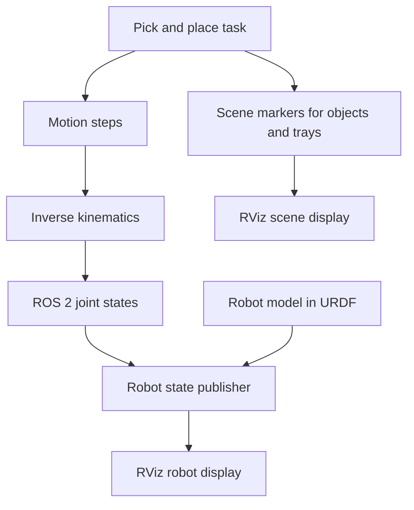

# Robotics Pick and Place

A step-by-step ROS 2 learning project for building a robot arm that picks up objects and places them in target locations.

## Project status

**Work in progress.** The repository is being built incrementally, starting with the ROS 2 package structure. The robot model, motion logic, and RViz demonstration will be added in later steps.

The first version will use predefined object coordinates and simulated grasping for visualization. Camera-based object detection, physics simulation, and physical robot control are future extensions.

## Planned architecture



## Planned learning milestones

- Create and build a ROS 2 Python package.
- Describe the robot arm using URDF.
- Implement and test forward and inverse kinematics.
- Create the pick-and-place task sequence.
- Add ROS 2 topics and services.
- Visualize the robot and scene in RViz.
- Add camera-based object detection as a future extension.

## Technologies

- ROS 2
- Python
- URDF
- RViz
- Colcon

## Development environment

The project is being developed in Ubuntu with ROS 2 Lyrical.

## Build

From the repository root:

```bash
source /opt/ros/lyrical/setup.bash
colcon build --symlink-install
source install/setup.bash
```

## Run

The launch command will be added after the launch file and demo node are implemented.

## Learning goals

This project is intended to practice:

- ROS 2 nodes, topics, and services
- Robot links, joints, and coordinate frames
- Forward and inverse kinematics
- Motion sequences and task state machines
- RViz visualization
- The steps required to extend a simulation toward perception and hardware

## Limitations of the first version

The initial demonstration will use known object positions. It will not detect objects with a camera, simulate physical contact, or send commands to real motors.